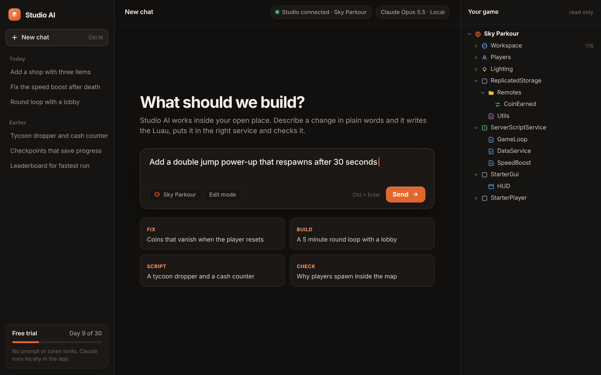
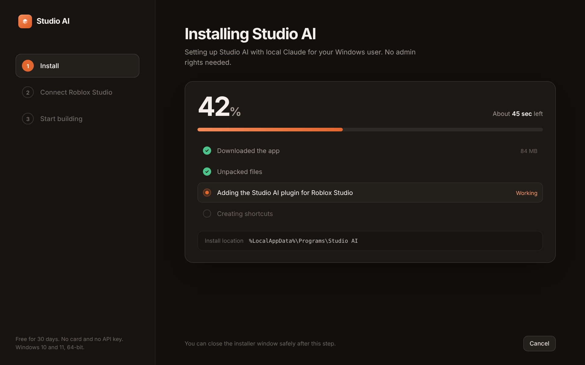
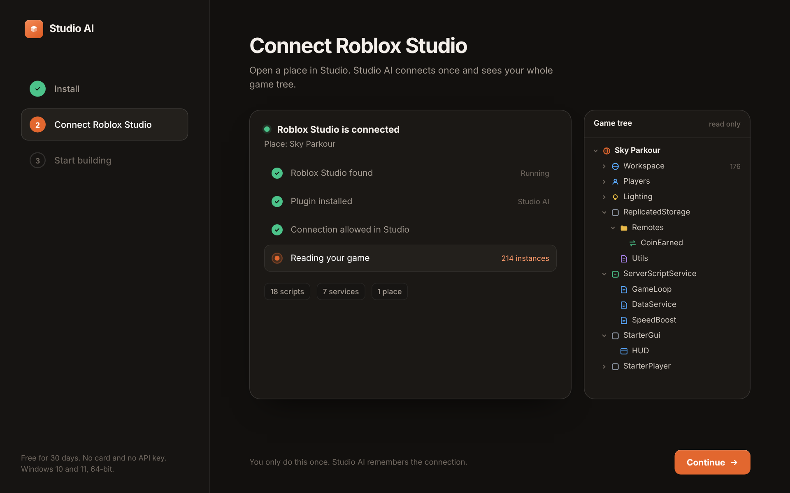
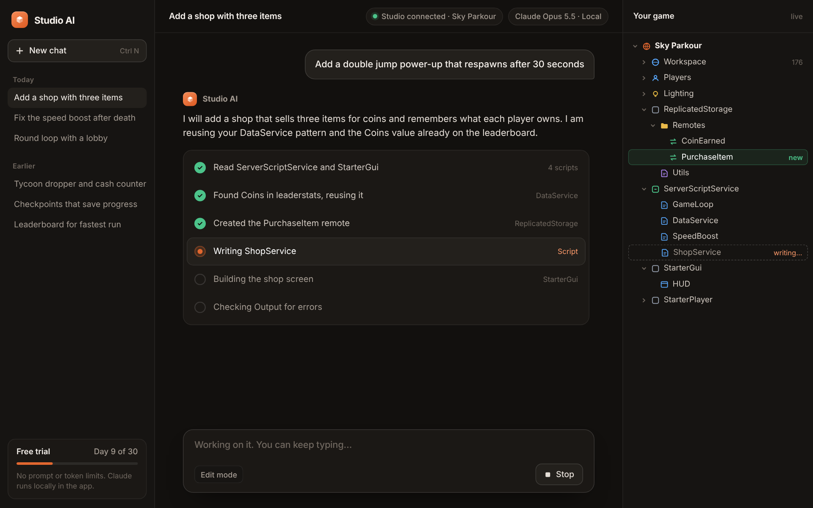
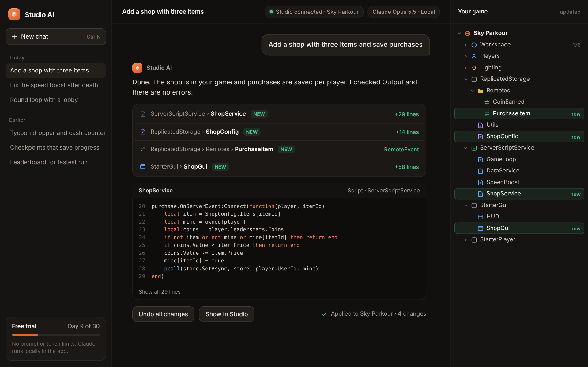

<div align="center">



# Studio AI for Roblox Studio

**A local AI assistant for building Roblox games. Claude runs inside the app on your PC and sees your open project.**

Describe a change in plain words. Studio AI writes the Luau, puts it in the right service and checks Output for errors.


</div>

---

## What is it

Studio AI is a desktop app plus a Roblox Studio plugin. The app is installed on your computer and connects to the place you have open in Studio. It reads the game tree, creates scripts, objects and interfaces, shows every change it makes, and lets you undo them all with one click.

**All you need is the app and Roblox Studio.** No API key, no account setup, no extra tools.

**Local Claude inside.** Claude is built into the app and works there as a local assistant: the app and the plugin live on your machine, and you never have to copy your project into a chat window.

## Features

- Describe a task in words and get ready-to-use Luau (Script, LocalScript, ModuleScript)
- Sees the whole game tree: Workspace, ServerScriptService, ReplicatedStorage, StarterGui and more
- Reuses what is already in your project (for example `DataService` or `leaderstats`)
- Creates remotes, modules and GUIs
- Checks Output for errors after each change
- Shows a change list with an **Undo all changes** button
- **Edit mode** applies changes directly to your game
- Chat history per project

## Screenshots

### 1. Install

Installs into your Windows user profile. No admin rights needed.



### 2. Connect Roblox Studio

Open a place in Studio. The plugin connects once and shows your game tree in read-only mode.



### 3. Working on a task

Claude reads the services it needs, finds existing pieces of your project and writes the code. You can keep typing while it works.



### 4. Result

A list of changes, a code preview, an Output check, and the **Undo all changes** and **Show in Studio** buttons.



## Installation

1. Download the installer from [Releases](https://github.com/BrawlerForge/roblox-studio-ai/releases)
2. Run it and wait for the install to finish (the app and the Studio plugin are installed together)
3. Open your place in **Roblox Studio** and allow the plugin connection
4. Click **Continue** and start a chat

**Requirements:** Windows 10 or 11 (64-bit) and Roblox Studio installed.

## Quick start

1. Launch Studio AI
2. Make sure the green `Studio connected` indicator is on at the top
3. Type what you want, for example:

```text
Add a shop with three items and save purchases
```

```text
Fix the speed boost that stays after death
```

```text
Make a 5 minute round loop with a lobby
```

4. Press **Ctrl + Enter**, review the changes and undo them if needed

## How it works

```text
┌──────────────────┐   local    ┌──────────────────────┐   plugin   ┌────────────────┐
│    Studio AI     │ ─────────▶ │  Claude (in the app) │ ─────────▶ │ Roblox Studio  │
│  (on your PC)    │ ◀───────── │  reads and edits     │ ◀───────── │  your project  │
└──────────────────┘            └──────────────────────┘            └────────────────┘
```

## Roadmap

- [x] Windows installer
- [x] Roblox Studio plugin connection
- [x] Chat with access to the game tree
- [x] Undo for all changes
- [ ] macOS
- [ ] Choice of other models
- [ ] Prompt templates
- [ ] Review of existing scripts

## Contributing

Pull requests and issues are welcome: [Issues](https://github.com/BrawlerForge/roblox-studio-ai/issues).

## Disclaimer

This project is not affiliated with Roblox Corporation. *Roblox* and *Roblox Studio* are trademarks of Roblox Corporation. Always review generated code before publishing your game.

## License

MIT. See [LICENSE](LICENSE).

---

<div align="center">

Made by **BrawlerForge**

</div>
